# Hesabe Payment Module for PrestaShop 8 and 9

Accept **KNET, Visa and Mastercard** through [Hesabe](https://hesabe.com) in the
PrestaShop checkout, and refund them from the order page. Each method is its own
payment option, and a third option opens Hesabe's own page with every method on
your account. The order is created only once Hesabe confirms the payment, so a
customer who abandons the KNET page leaves no cancelled order and holds no stock.
Customers and employees see the module in **English or Arabic**.

| | |
|---|---|
| PrestaShop version | 8.1 and later, including 9. Tested on 8.2.8 and 9.2.0 |
| PHP | 8.1 or later |
| Install | One zip in Module Manager, or four commands on the server |
| Currency | KWD only: Hesabe and KNET settle in Kuwaiti Dinar |
| Languages | English, Arabic |
| Licence | MIT |

Every payment path in this guide was run against Hesabe's sandbox in October 2026:
KNET, cards through MPGS with 3-D Secure, Hesabe's own page, cancelling on the KNET
page, and refunds. CI repeats the KNET, Hesabe-page and cancel payments on every
push, in clean PrestaShop 8.2.8 and 9.2.0 shops. The module has not yet taken a
production payment; Hesabe's production gateway and refunds were probed through
[hesabe-php](https://github.com/ruptyx/hesabe-php), the SDK it is built on.

---

## 1. Add Kuwaiti Dinar

The module offers its options only for a cart in KWD. Go to **International →
Localization → Currencies**, click **Add new currency**, choose **Kuwaiti Dinar**
and save. Check that **Decimals** is `3`: KNET amounts are in fils.

Add it before installing the module. PrestaShop allows a payment module every
currency that exists when the module is installed (9.2.0, October 2026); step 4
shows where to check.

## 2. Install the module

Download `hesabe.zip` from the
[latest release](https://github.com/ruptyx/hesabe-prestashop/releases/latest).

Go to **Modules → Module Manager**, click **Upload a module** and drop the zip.

<!-- screenshot: docs/screenshots/01-upload-module.png -->
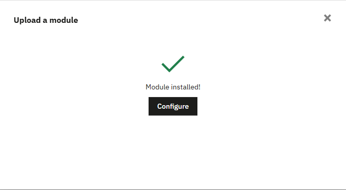

Hesabe is then listed in Module Manager.

<!-- screenshot: docs/screenshots/02-module-list.png -->
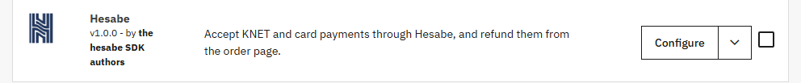

Or from the command line, in the PrestaShop folder:

```bash
curl -fL -o /tmp/hesabe.zip \
  https://github.com/ruptyx/hesabe-prestashop/releases/latest/download/hesabe.zip
unzip -o /tmp/hesabe.zip -d modules/
php bin/console prestashop:module install hesabe
php bin/console cache:clear --no-warmup
```

The cache clear makes the module's own console command, used in step 3, visible on
PrestaShop 8 (8.2.8, October 2026).

## 3. Enter your credentials

Click **Configure** on the module.

<!-- screenshot: docs/screenshots/03-settings.png -->
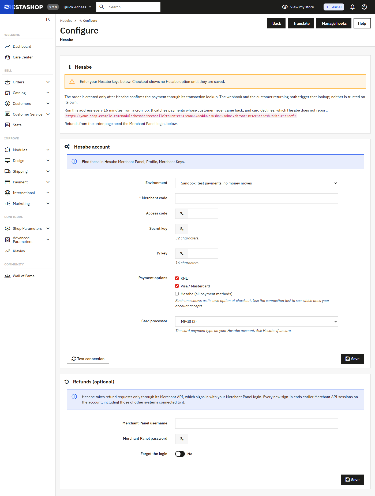

Under **Hesabe account**, fill in the values from your Hesabe **Merchant Panel →
Profile → Merchant Keys**:

| Field | Notes |
|---|---|
| Environment | **Sandbox** (`sandbox.hesabe.com`) or **Production** (`api.hesabe.com`) |
| Merchant code | Digits, e.g. `842217`, Hesabe's public sandbox merchant |
| Access code | UUID from the Merchant Panel |
| Secret key | 32 characters |
| IV key | 16 characters |
| Payment options | **KNET**, **Visa / Mastercard**, **Hesabe (all payment methods)**: each one ticked is its own option at checkout |
| Card processor | **MPGS (2)** or **CyberSource (5)**: the card payment type on your Hesabe account |

<!-- screenshot: docs/screenshots/04-credentials.png -->
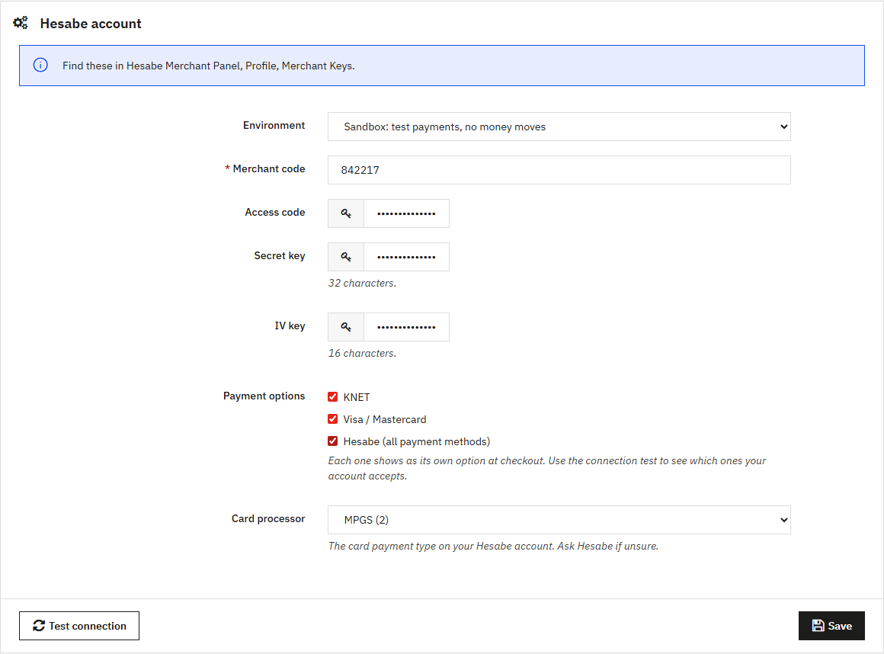

There is no URL to configure: the environment selects the gateway, so a shop left on
the sandbox can never reach the live one. A key field left empty keeps the value
already saved.

Press **Save**, then **Test connection**. For each option, Hesabe either opens a
payment session or says why not. Nothing is charged.

<!-- screenshot: docs/screenshots/05-test-connection.png -->
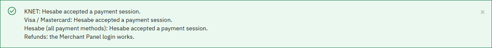

Hesabe refuses a payment type the account lacks with code 424, "Invalid Payment
Method" (October 2026). Email support@hesabe.com to enable it, then test again.

The keys are stored encrypted with the shop's own cookie key. PrestaShop's SQL
Manager hides only passwords and secure keys, so a plain value in the configuration
table would be readable by every employee with SQL access.

To script the setup, `hesabe:configure` reads the same `HESABE_*` variables as the
Hesabe SDKs, from the environment, so no key lands in the shell history:

```bash
HESABE_ENVIRONMENT=sandbox \
HESABE_MERCHANT_CODE=... HESABE_ACCESS_CODE=... \
HESABE_SECRET_KEY=... HESABE_IV_KEY=... \
HESABE_MERCHANT_USERNAME=... HESABE_MERCHANT_PASSWORD=... \
php bin/console hesabe:configure --methods=knet,card --card-type=2
```

PrestaShop's own `prestashop:module configure` would store the keys in plain text,
which is why the module has its own command.

### Optional: Refunds

Below the account sits a **Refunds (optional)** section with **Merchant Panel
username** and **Merchant Panel password**. These are your Hesabe *panel* login, not
more gateway keys: Hesabe takes refund requests only through its Merchant API, which
signs in with that login. Leave them empty and the module works as a plain checkout,
with no refund form on the order page.

<!-- screenshot: docs/screenshots/06-refund-login.png -->
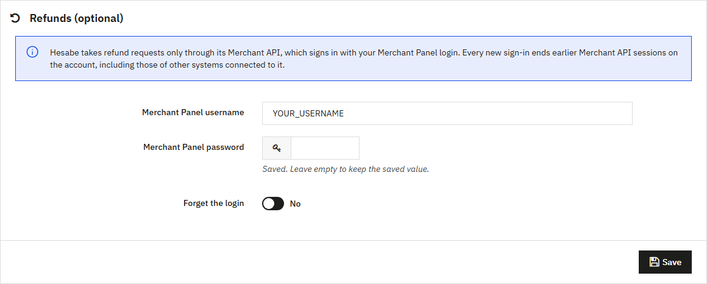

With the login saved, **Test connection** also reports *Refunds: the Merchant Panel
login works.* **Forget the login** removes it.

> ⚠️ Hesabe keeps one Merchant API session per account: every new sign-in ends the
> earlier ones (probed on production, October 2026). Another system that signs in
> with the same login, Odoo for example, signs the shop out, and the shop signs it
> out in turn. The module keeps its session, encrypted, and reuses it to sign in as
> rarely as it can. A refund sent after another sign-in is turned away before Hesabe
> records it: the order page says nothing was sent, and the next refund signs in again.

## 4. Payment options

Each ticked option shows at checkout for a cart in KWD.

<!-- screenshot: docs/screenshots/07-checkout.png -->
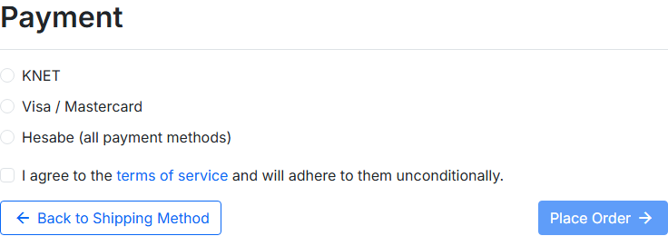

- **KNET** sends the customer straight to KNET's payment page.
- **Visa / Mastercard** sends the customer to the card page of the processor chosen
  in **Card processor**. With MPGS that is Mastercard's checkout, with 3-D Secure
  (sandbox, October 2026).
- **Hesabe (all payment methods)** opens Hesabe's own page, which lists every method
  on your account, including ones PrestaShop has no option for.

If no Hesabe option shows, open **Payment → Preferences → Currency restrictions**:
KWD must be ticked in the Hesabe column.

<!-- screenshot: docs/screenshots/08-currency-restrictions.png -->
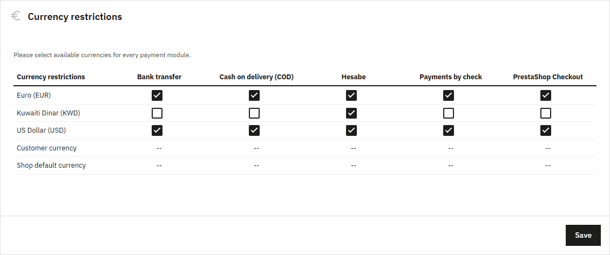

## 5. Schedule the reconciler

The top of the settings page shows a reconcile address with a token.

<!-- screenshot: docs/screenshots/09-reconcile-address.png -->
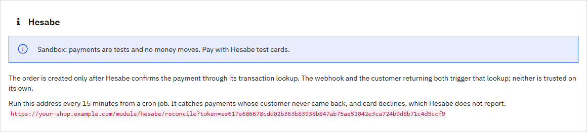

Call it every 15 minutes from cron:

```bash
*/15 * * * * curl -fsS "https://your-shop.example.com/module/hesabe/reconcile?token=..." >/dev/null
```

It looks up every payment still open and answers with what it checked, for example
`{"ok":true,"checked":{"pending":3}}`. A wrong token answers 403. See
[How payments are confirmed](#how-payments-are-confirmed) for why it is needed.

---

## Paying at checkout

The customer chooses an option and presses **Place order**. No order exists yet: the
module records the attempt and sends the customer to Hesabe. With KNET they land on
KNET's page.

<!-- screenshot: docs/screenshots/10-knet-page.png -->
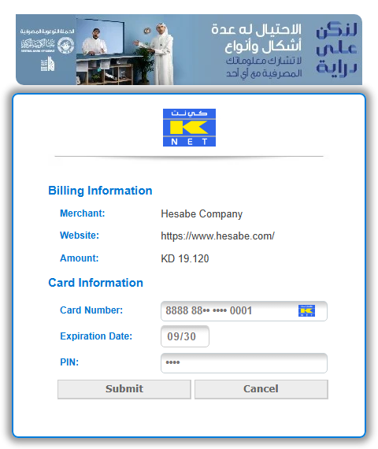

Once Hesabe confirms the payment, the order is created as **Payment accepted** and
the customer sees the confirmation with the payment reference.

<!-- screenshot: docs/screenshots/11-order-confirmation.png -->
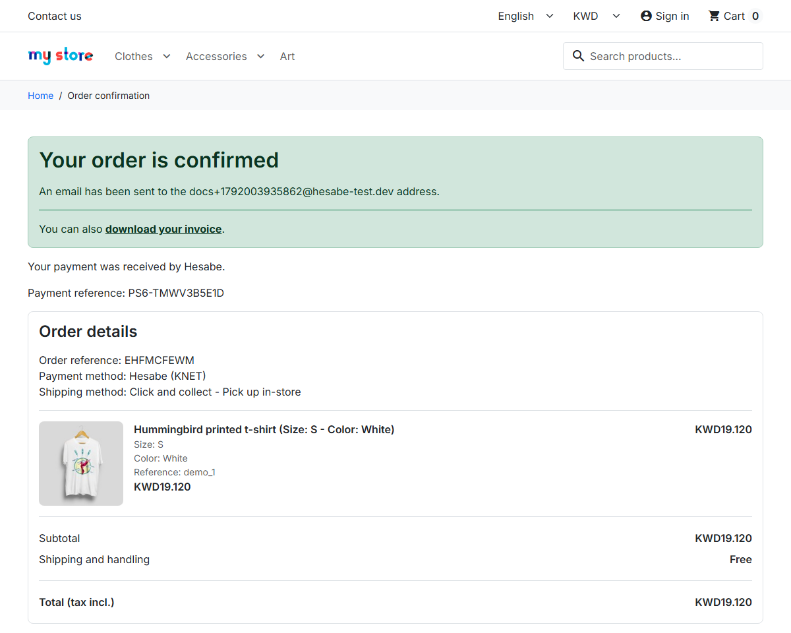

- If Hesabe has not confirmed the payment yet, the customer sees **Confirming your
  payment**, a page that checks again every five seconds, six times, then tells them
  the order will appear in their order history.
- A customer who cancels on KNET's page goes back to checkout with the cart intact
  and the message *The payment was not completed. You have not been charged; please
  try again.*
- After a declined card Hesabe neither sends the customer back nor reports anything
  (sandbox, October 2026), so no order is created and the reconciler closes the
  attempt after four days.

## Refunding an order

Open the order in **Orders → Orders**. The **Hesabe** panel shows the method, amount,
reference, Hesabe's token and the payment status, and a refund form when the
Merchant Panel login is saved. The form starts at what is left to refund.

<!-- screenshot: docs/screenshots/12-order-panel.png -->
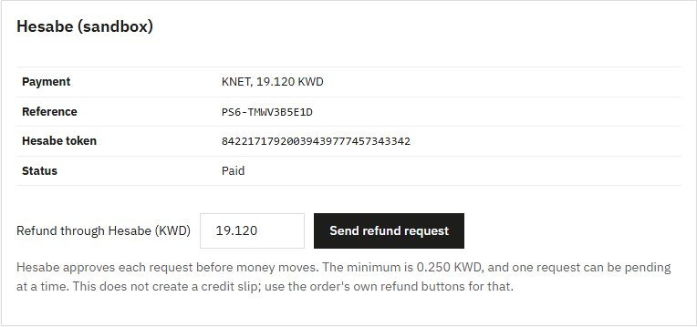

Enter an amount and press **Send refund request**.

<!-- screenshot: docs/screenshots/13-refund-sent.png -->
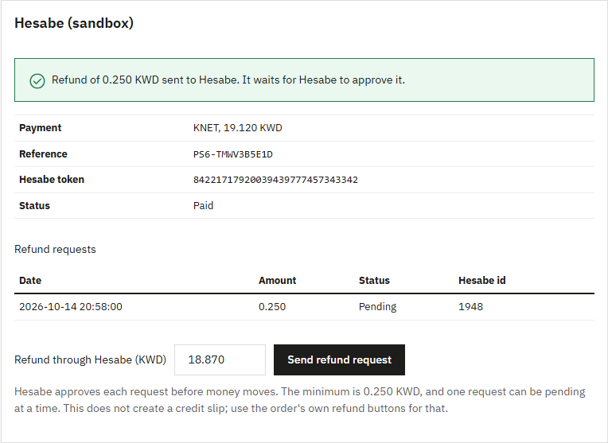

What Hesabe does with a refund, as probed in October 2026:

- A refund is a request. It shows as **Pending** until Hesabe approves it. While a
  request is pending, opening the order page reads its status again, at most every
  five minutes.
- On production, a full refund of 0.250 KWD sent with
  [hesabe-php](https://github.com/ruptyx/hesabe-php) was approved automatically 21
  minutes later, with the remark "Auto Refund Approved" (13 October 2026).
- The minimum is 0.250 KWD, on the sandbox and on production. A payment holds one
  pending request at a time (sandbox).
- A refund of the whole amount is sent as a full refund, anything less as partial.
- When no answer comes back, the request is listed as **No answer: check the
  Merchant Panel** and its amount stays held. Hesabe has no idempotency keys, so the
  module never sends a request twice. Check **Refunds** in the Merchant Panel before
  sending another.

The form does not create a credit slip. Use the order's own refund buttons for the
accounting side.

## Arabic

The module is translated into Arabic: the checkout options, the confirmation, the
pending page, the settings page and the order panel. PrestaShop shows the Arabic to
customers and employees whose language is Arabic, once the shop has it (**International
→ Translations → Add / Update a language**).

<!-- screenshot: docs/screenshots/14-checkout-arabic.png -->
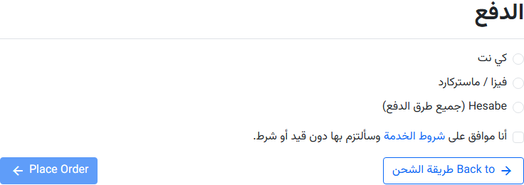

"Hesabe" and the Merchant Panel menu names stay in Latin script; KNET is written
كي نت. Text outside the module, such as **Place Order** above, comes from
PrestaShop's own language pack.

## Going live

Switch **Environment** to **Production**, enter the production keys, save, and press
**Test connection**. Pay one small real order with KNET, then refund it from the
order page. Hesabe's smallest refund is 0.250 KWD, so pay at least that.

---

## How payments are confirmed

Hesabe signs nothing it sends. Its redirect data is encrypted but carries no
integrity check and passes through the customer's browser, and its webhook is plain,
unsigned JSON. Both are treated as a hint, never as evidence:

1. The customer pays. Hesabe calls the shop's webhook and sends the customer back,
   the webhook a few seconds first (five to six seconds on the sandbox, 14 October
   2026).
2. Either one triggers a lookup at Hesabe, `GET api/transaction/<reference>`. The
   webhook body and the redirect data are not read at all.
3. Only a lookup that reports the payment successful creates the order, with the
   amount Hesabe reports.
4. If that amount differs from the cart total, because the cart changed in another
   tab during payment, PrestaShop files the order under **Payment error** for a
   person to look at.

The return and webhook addresses carry an HMAC of the reference, so a guessed address
triggers no lookup; the webhook answers it with 404.

The reconciler covers what never comes back: customers who close the tab, webhooks
that never arrive, and card declines. Hesabe reports a declined card or a failed 3-D
Secure nowhere: no redirect, no webhook, and the lookup answers 404 (sandbox, October
2026). An open attempt is first looked up 15 minutes after checkout, then at doubling
intervals up to once a day. After four days it is marked **Expired**, about eleven
lookups in all.

**One order per cart.** PrestaShop does not prevent two orders for one cart, and the
webhook and the customer arrive seconds apart. Settlement holds a MySQL lock per
cart. A second payment for a cart that already has an order is marked **Paid twice:
refund by hand** and logged.

**Three decimals.** A webhook or cron request starts in the shop's default currency,
and PrestaShop caches that currency's rounding. Settlement switches to the cart's
currency and clears the cache first, so a shop whose default currency has two
decimals still records 19.120, not 19.12 (PrestaShop issue #43205).

## References

Each payment attempt gets its own order reference, `PS<cart id>-<suffix>`, such as
`PS6-TMWV3B5E1D`. The Hesabe Merchant Panel shows it as the order reference, and the
customer sees it on the confirmation page, so a payment can be matched to its cart by
eye. A retry gets a new reference, so a lookup always names exactly one payment.

The reference holds only letters, digits and hyphens, which every Hesabe product
keeps intact; Hesabe's invoice API strips other separators.

Once paid, Hesabe's token for the payment is stored as the order payment's
**Transaction ID**. Refunds name the payment by that token.

## Dependencies

The zip carries [hesabe-php](https://github.com/ruptyx/hesabe-php) 1.0.1, the Hesabe
SDK for PHP, under `vendor/`. Nothing is installed with Composer on the server.
hesabe-php needs only PHP's `curl`, `json` and `openssl` extensions, which PrestaShop
requires anyway. `composer.lock` pins the SDK version, and `scripts/build.sh` builds
`build/hesabe.zip`.

## Local testing

`dev/docker-compose.yml` runs a shop with this repository mounted as the module.
Hesabe must reach the shop, so put a public HTTPS address in front of port 8080, a
Cloudflare quick tunnel for example, and pass its host:

```bash
docker run -d --name tunnel cloudflare/cloudflared tunnel --url http://host.docker.internal:8080
PS_DOMAIN=<tunnel host> PS_ENABLE_SSL=1 docker compose -f dev/docker-compose.yml up -d
docker compose -f dev/docker-compose.yml exec -u www-data shop sh -c \
  'php bin/console prestashop:module install hesabe && php modules/hesabe/dev/setup-shop.php'
```

The back office is then at `https://<tunnel host>/admin-dev` (`demo@example.com` /
`prestashop_demo`). `PS_IMAGE=prestashop/prestashop:8.2.8-8.1-apache` selects
PrestaShop 8. `dev/setup-shop.php` adds KWD and a carrier for Kuwait to the demo
shop. Adding `-f dev/docker-compose.clean.yml` leaves the repository unmounted, to
install the built zip the way a merchant does.

Hesabe's published sandbox credentials are in its developer documentation, and the
CI workflow uses them. Test cards:

| Method | Card |
|---|---|
| KNET | `8888880000000001`, expiry `09/30`, PIN `1234` |
| Visa / Mastercard (MPGS) | `5123450000000008`, expiry `01/39`, CVV `100`; choose *Authentication Successful* on the 3-D Secure emulator |

`tests/e2e/` drives real sandbox payments with Playwright: guest checkout, KNET's
test page, the return and the order confirmation. `refund.mjs` sends a refund from
the order page, `settings.mjs` saves the settings and runs the connection test, and
`upload.mjs` installs the zip through Module Manager.

```bash
cd tests/e2e && npm install
SHOP_URL=https://<tunnel host> node checkout.mjs knet          # or hosted, or: knet cancel
SHOP_URL=https://<tunnel host> ORDER_ID=1 node refund.mjs 0.250
```

`SHOP_LANG=ar` runs the checkout in Arabic, once the shop has the Arabic language.
KNET's sandbox page sometimes stays blank, stops answering **Submit**, or does not
take the test card number, most often for payments started on Hesabe's own page;
`checkout.mjs` then exits with code 75, and CI starts a fresh payment, up to three
times.

`translations/ar.php` keys each Arabic string by the source file and the md5 of the
English text, as PrestaShop looks it up, so rewording an English string drops its
translation. `php scripts/translations.php` lists any string without an entry and any
entry no string uses; CI runs it, along with PHPStan against PrestaShop 8.2.8 and
9.2.0.

## Troubleshooting

| Symptom | Cause |
|---|---|
| No Hesabe option at checkout | The cart is not in KWD, the keys are not saved, or KWD is not ticked for Hesabe under **Payment → Preferences → Currency restrictions**. |
| *The payment could not be started* at checkout | Hesabe refused the payment session. **Test connection** shows the option and Hesabe's reason; code 424 means the payment type is not enabled on the account. |
| The customer paid but no order appeared | Neither the webhook nor the customer's return reached the shop: it is not on public HTTPS, or it is in maintenance mode. Call the reconcile address, or wait for the next cron run. |
| An order under **Payment error** | The amount Hesabe reports differs from the cart total, usually because the cart changed in another tab during payment. |
| Hesabe panel says **Paid twice: refund by hand** | The customer paid twice for one cart. Refund the second payment from the Hesabe Merchant Panel. |
| Hesabe panel says **Paid, order not created** | Hesabe took the payment but PrestaShop refused the order. The log line gives PrestaShop's reason. |
| No refund form on the order page | The Merchant Panel login is not saved, or the payment is not **Paid**. |
| Refund: *No answer from Hesabe* | The request may or may not exist at Hesabe. Check **Refunds** in the Merchant Panel before sending another. |
| Refund: *Nothing was sent: Hesabe signed the shop out* | Another sign-in with the same Merchant Panel login ended the shop's session. Hesabe did not take the request (sandbox, October 2026), so the amount is free again. Send the refund again: the shop signs in afresh. Give each system its own Hesabe user if your account allows it. |
| Refund refused below 0.250 KWD | Hesabe's minimum, on the sandbox and on production. |

Problems are logged in **Advanced Parameters → Logs**, each line starting with
`Hesabe`:

```
Hesabe payment <reference> was paid after cart <id> already had order <id>. Refund it from the Hesabe Merchant Panel.
```

## Licence

MIT. See `LICENSE`.
